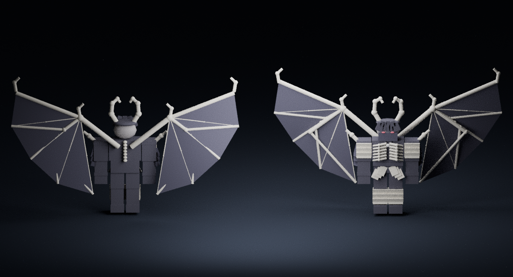

# Модели и подключение MeshPart

В папке 43 реальные пары `.obj` / `.mtl`: собственная геометрия оружия, брони, крыльев, водного дракона, ястреба и костяной руки. `manifest.json` содержит имена, размеры, центр, количество частей исходного шаблона и вершин. Это экспорт составных рабочих моделей, а не скульптуры качества приложенного изображения.

Сборка использует готовые модели из `ReplicatedStorage.BlackClover.ArtTemplates`. Папка `ArtMeshes` предназначена для более детальных замен; `MagicArt` предпочитает их автоматически. Никакие фиктивные `rbxassetid://...` не подставлены, загрузка ресурсов в Roblox от имени пользователя не выполнялась.

## Импорт

1. Сохраните копию place. В Studio откройте **3D Importer / Import 3D** и выберите нужный OBJ. Держите одноимённый MTL рядом; проверьте материалы в предпросмотре импортера.
2. Импортируйте только геометрию, без чужих скриптов. Если Roblox запросит загрузку mesh-ресурсов, выполните её под владельцем игры/группой с нужным доступом. Это действие требует вашей сессии Roblox Studio.
3. Назовите импортированный **Model** или **MeshPart** точно как шаблон: например `AntiSword`, `BoneWingLeft`, `BoneArmorUpperTorso`, `Dragon`. Переместите в `ReplicatedStorage → BlackClover → ArtMeshes`. Другие имена не подключаются.
4. Для составного Model сохраните пропорции и ориентацию: Y вверх, перед персонажа/морда дракона — отрицательная Z. `MagicArt` нормализует общий размер и центр по исходному шаблону, создаёт собственный невидимый Root и привязки. Для одиночного MeshPart размер задаётся по bounding box шаблона. Масштаб проверьте в Play, особенно у рогов, длинного оружия и больших крыльев.
5. Крылья импортируйте **раздельно**, левое и правое, а броню — отдельно для каждого R15-сегмента. Оружие направлено лезвием по +Y; начало модели находится у хвата. Не объединяйте всю форму в неподвижный единый mesh: пропадёт движение вместе с суставами.
6. Запустите Play: M → класс → G; проверьте открытие крыльев, бег, каст, M1, смерть и повторное включение. Затем сохраните новый `.rbxlx` из Studio. Изменения place не попадают обратно в исходные OBJ автоматически.

Для собственного детального дизайна откройте OBJ в Blender, доработайте топологию, материалы и UV; экспортируйте в поддерживаемый Roblox формат. Сохраняйте общий силуэт, ориентиры хвата/суставов и разумный бюджет полигонов. При сильно изменившемся bounding box потребуется настройка `MagicArt:Clone` и смещений `MagicEquipment:Armor/Weapon`.

## Имена ресурсов

| Семейство | Имена |
|---|---|
| Оружие | `AntiSword`, `WaterSpear`, `BoneSpear`, `WindWeapon` |
| Крылья | `{Bone,Water,Wind,Anti}Wing{Left,Right}` — 8 моделей |
| Сегменты брони | `{Bone,Water,Wind,Anti}Armor{UpperTorso,LowerTorso,Head,LeftUpperArm,RightUpperArm,LeftLowerLeg,RightLowerLeg}` — 28 моделей |
| Крупные заклинания | `Dragon`, `Hawk`, `BoneHand` |

Итого 43 шаблона. При работе с гримуарами сохраняйте шарниры крышек и отдельную страницу в `GrimoireManager`; простая подмена книги неподвижным OBJ отключила бы перелистывание. Их детальные уникальные обложки сейчас создаются процедурно, отдельный комплект MeshPart книг не подготовлен.

Голем хранится отдельно в `ServerStorage.Actors.Golem`. Его нельзя заменить одной декоративной деталью через `ArtMeshes`: серверному NPC нужны Humanoid, HumanoidRootPart, корректные размеры и 15 Motor6D. Детальные каменные поверхности привязывайте к существующим сегментам R15.

## Что ещё отсутствует

- Загруженные и проверенные на доступ к игре MeshPart с детальной скульптурой и UV/PBR-материалами.
- Мех/волосы и резные органические поверхности костяной формы уровня изображения; точные художественные модели доспехов и оружия остальных референсов.
- Отдельные изображения Noelle, Wind, Anti, Grimoare, упомянутые в задании; доступным был только костяной демон.
- Специализированные аудиозаписи магии и доводка кинематографических анимаций в Roblox. Сейчас используются процедурные позы и встроенные звуки.

Это осмотр реальной исходной геометрии в Blender, **не** скриншот Studio. Рёбра находятся спереди, позвоночник — сзади; дополнительные материалы и анимации Roblox на этом изображении не воспроизводятся.
